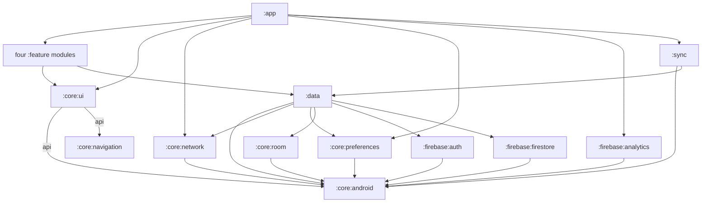
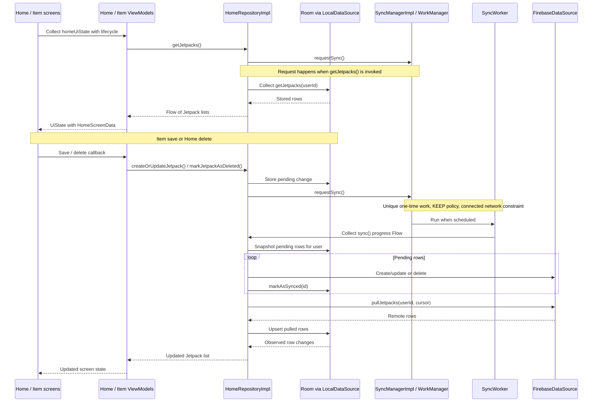

# Architecture Overview

The app has two layers: feature modules own screens and ViewModels, and `:data` owns repository
interfaces, implementations, and the models they expose. Data sources in core and Firebase modules
handle storage and external services. There is no separate domain module.

Start with the responsibility you need to change:

| Change | Main home |
|---|---|
| Screen layout, user interactions, screen state | `feature/*` Composables, ViewModels, and screen-data classes |
| Reusable UI, state helpers, navigation infrastructure | `core/ui`, `core/navigation` |
| Data operations and coordination between sources | `data` repositories |
| Local SQL storage, preferences, REST, authentication, Firestore | `core/room`, `core/preferences`, `core/network`, `firebase/auth`, `firebase/firestore` |
| Background execution and sync scheduling | `sync` |
| Application assembly, theme, feature entry registration | `app` |

## Module Dependencies

Arrows below mean **declared project dependencies**, pointing from consumer to dependency. They do
not represent the order of runtime calls. The table supplies the individual modules behind grouped
nodes and separates development tooling from application dependencies.



| Module | Direct project dependencies and special relationships |
|---|---|
| `:app` | `implementation`: `core:ui`, `core:network`, `core:preferences`, all four features, `firebase:analytics`, `sync`; `baselineProfile`: `benchmarks` |
| `:feature:auth`, `:feature:home`, `:feature:profile`, `:feature:settings` | Each uses `implementation` for `core:ui` and `data`; Home and Settings also use `testImplementation(core:testing)` |
| `:data` | `implementation`: `core:android`, `core:network`, `core:preferences`, `core:room`, `firebase:auth`, `firebase:firestore`; `testImplementation`: `core:testing` |
| `:sync` | `implementation`: `core:android`, `data` |
| `:core:ui` | `api`: `core:android`, `core:navigation`; `lintPublish`: `lint`; `testImplementation`: `core:testing` |
| `:core:network`, `:core:preferences`, `:core:room` | Each uses `implementation(core:android)` |
| `:firebase:auth`, `:firebase:firestore`, `:firebase:analytics` | Each uses `implementation(core:android)` |
| `:core:android`, `:core:navigation` | No direct project dependencies |
| `:core:testing` | `implementation(core:android)`; `api(core:preferences)` and `api(firebase:auth)` expose the types used by shared fakes |
| `:benchmarks` | Targets `:app` through `targetProjectPath`; generates baseline profiles and runs benchmarks |
| `:lint` | Standalone JVM lint checks, published with `core:ui` for consumers' lint runs |

`api` makes dependency types available to consumers: a feature gets navigation types through
`core:ui`. `implementation` does not expose those dependencies on the consumer's compile classpath.
Test helpers, lint checks, and profile generation have different roles from application code;
including them as ordinary runtime arrows would obscure those boundaries. External libraries and
the included `build-logic` build are omitted; see [Build & Tooling](build-and-tooling.md) for
convention plugins and their shared configuration.

## UI and State Management

A destination's `Screen` obtains its ViewModel through Hilt and collects state with
`collectAsStateWithLifecycle()`. Screen callbacks invoke ViewModel methods. The ViewModel calls
repositories and updates a `UiState<T>` containing screen data, a loading flag, and a one-time error
event. `StatefulComposable` renders that wrapper.

These are shortened excerpts from `HomeViewModel`; imports, annotations, and other members are
omitted. The actual screen-data property is `jetpacks`:

```kotlin
data class HomeScreenData(
    val jetpacks: List<Jetpack> = emptyList(),
)

private val _homeUiState = MutableStateFlow(UiState(HomeScreenData()))

val homeUiState = _homeUiState
    .onStart { getJetpacks() }
    .stateInDelayed(UiState(HomeScreenData()), viewModelScope)

fun deleteJetpack(jetpack: Jetpack) {
    _homeUiState.updateWith {
        homeRepository.markJetpackAsDeleted(jetpack)
    }
}
```

`getJetpacks()` collects the repository Flow into screen state. Its collector is launched in
`viewModelScope`; lifecycle-aware screen collection does not itself stop that repository collector.
Restarting the shared state upstream can launch another collector. See
[State Management](state-management.md) for the helpers and the behavior review in
[the repair record](https://github.com/atick-faisal/Jetpack-Android-Starter/blob/fix/docs-v3/DOC_FIX_TASKS.md#behavior-ledger)
for the known collector and error-delivery limitations.

## Data and Dependency Injection

Repositories provide the interface used by ViewModels. Observable reads return `Flow`, while
one-time operations such as saving return `Result`. Data sources perform the underlying IO.

The source of observed data depends on the repository:

- Home reads Jetpack rows from Room. Firestore updates reach the screen through writes to Room.
- Settings and Profile read user preferences from DataStore.
- Authentication operations call `AuthDataSource`. After a successful sign-in or registration,
  `AuthRepositoryImpl` stores the returned user profile through `UserPreferencesDataSource`.
  Home then uses the stored user ID for its list and sync operations. This is an explicit write
  after an auth operation, not an authentication-listener pipeline.
- `core:network` provides Retrofit REST access. An adopter can use REST, Firestore, or coordinate
  both in a repository according to the feature's needs; Home's sync path currently uses Firestore.

Hilt constructs ViewModels, repositories, and data sources. Repository modules bind implementations
to interfaces; data-source modules bind implementations or construct dependencies with `@Provides`.
See [Data Layer](data.md) for construction, dispatchers, and persistence details.

### The SyncManager Boundary

`SyncManager` is declared in `:data`. `HomeRepositoryImpl` calls that interface to request work.
`:sync` depends on `:data` and supplies `SyncManagerImpl`; its `SyncModule` binds the implementation
with `@Binds` in `SingletonComponent`. The app includes `:sync`, allowing Hilt to assemble the graph.

At runtime, a repository can therefore call into the sync implementation without a Gradle
`data → sync` dependency. The worker calls back into `HomeRepository.sync()`. These runtime calls
do not create a module dependency cycle.

## How It Fits Together

This sequence follows Home's existing operations. The worker portion illustrates a pass scheduled
after a local edit; WorkManager controls when it actually starts.



Home starts with its initial empty screen data, then displays Room emissions; it does not wait for
a remote response to display stored rows. Sync is request-triggered one-time work, with no periodic
schedule configured. `getJetpacks()` requests work even if its returned Flow is never collected.
Save/delete operations request work after recording the local change.

A request made while matching unfinished work exists is ignored by `KEEP`; that request does not
guarantee a later pass. Sync snapshots pending rows once, and push-before-pull does not protect edits
made during the pass: acknowledgement can clear a newer edit's pending status, and a pull can
overwrite local content. The diagram describes operation order, not a conflict-resolution guarantee.
The [behavior ledger](https://github.com/atick-faisal/Jetpack-Android-Starter/blob/fix/docs-v3/DOC_FIX_TASKS.md#behavior-ledger)
records these limitations and follow-ups. See [Data Layer](data.md) for the detailed sync path.

## Domain Layer

ViewModels currently call repositories directly. Add a use-case boundary when complex business
rules need independent testing or several ViewModels need the same orchestration. A model mapping
or a second screen alone does not require a new layer. Keep simple source coordination in a
repository and screen-specific state in its ViewModel.

## Testing

Android convention plugins configure JUnit, coroutines testing, Turbine, Truth, and Robolectric for
Android application/library unit tests. Compose test support comes from the Compose configuration.
`:core:testing` supplies shared fakes and `MainDispatcherRule` to modules that explicitly declare it
as a test dependency; it is not automatically added to every module.

For a concrete repository test, read
[`SettingsRepositoryImplTest`](https://github.com/atick-faisal/Jetpack-Android-Starter/blob/fix/docs-v3/data/src/test/kotlin/dev/atick/data/repository/settings/SettingsRepositoryImplTest.kt).
It constructs the repository with fake auth and preferences sources, collects `getSettings()` with
Turbine, changes a preference through the repository, and checks the next Flow emission. Other cases
verify writes and failed `Result` values. Run it with:

```bash
./gradlew :data:testDebugUnitTest --tests 'dev.atick.data.repository.settings.SettingsRepositoryImplTest'
```

Use `MainDispatcherRule` for ViewModel tests that use `Dispatchers.Main`; see
[`ItemViewModelTest`](https://github.com/atick-faisal/Jetpack-Android-Starter/blob/fix/docs-v3/feature/home/src/test/kotlin/dev/atick/feature/home/ui/item/ItemViewModelTest.kt).
These examples demonstrate specific behavior; they do not establish sync concurrency, upgrade, or
complete application coverage. [Adding Features](guide.md#testing) links to further test support.

## Further Reading

- [State Management](state-management.md) — state updates, loading, and errors
- [Data Layer](data.md) — repository operations, persistence, and sync
- [Navigation](navigation.md) — destination keys, ViewModel arguments, and back stacks
- [Adding Features](guide.md) — changes across the layers
- [Build & Tooling](build-and-tooling.md) — convention plugins and validation commands
