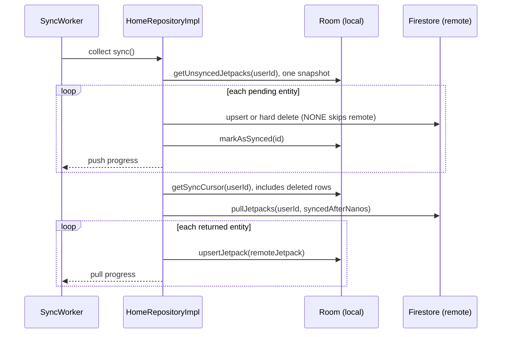

# Data Layer

Repositories combine data sources and expose data to ViewModels. This guide explains how to choose
storage, wire dependencies, extend persistence, and follow the Home feature's current sync behavior.
See [Architecture](architecture.md#module-dependencies) for the module graph.

## Data sources

Choose the pattern for the feature rather than adding every source to every repository:

| Reader need | Source and existing example | Behavior |
|---|---|---|
| Small local settings/profile | Typed JSON DataStore; `SettingsRepositoryImpl`, `ProfileRepositoryImpl` | Observe preferences as a `Flow`; update the serialized object locally. Auth sign-out is a separate operation. |
| Relational local data with background remote access | Room and Firestore; `HomeRepositoryImpl` | Screens observe Room; local writes request background sync. See the limitations below. |
| Explicit REST request | Retrofit; `NetworkDataSource.getPosts()` / `getPost(id)` | Suspend calls return DTOs or throw. No supplied repository connects these posts to a screen or persists them. |
| Authentication | Firebase Auth; `AuthRepositoryImpl` | Sign in/register through the auth source, then store profile fields in preferences. |

For a REST-only extension, add a repository interface and constructor-injected implementation in
`:data`, bind it in `RepositoryModule`, and map `NetworkPost` into your feature's data model. Wrap
one-time requests in `suspendRunCatching`. Add observable local storage only if the feature needs it;
a successful request alone does not supply an offline cache or a freshness policy.

The existing REST implementation moves the request to its injected dispatcher:

```kotlin
// NetworkDataSourceImpl method excerpt; constructor/imports omitted.
override suspend fun getPosts(): List<NetworkPost> {
    return withContext(ioDispatcher) {
        jetpackRestApi.getPosts()
    }
}
```

Firestore snapshot listeners, TTL caching, and a manual refresh UI are possible extensions, not
current Home behavior. A listener needs its own subscription cleanup and local merge policy; a cache
needs an explicit expiry/refresh policy. The existing Firestore pull uses `get()`, not a listener.

## Repository pattern

Home exposes observable Room data and one-time local operations:

```kotlin
// HomeRepository interface excerpt; package/imports omitted.
interface HomeRepository : Syncable {
    fun getJetpacks(): Flow<List<Jetpack>>
    fun getJetpack(id: String): Flow<Jetpack>
    suspend fun createOrUpdateJetpack(jetpack: Jetpack): Result<Unit>
    suspend fun markJetpackAsDeleted(jetpack: Jetpack): Result<Unit>
}
```

`HomeRepositoryImpl.getJetpacks()` calls `requestSync()` when the method constructs the Flow,
including when nobody collects it. Collection then reads the user ID from preferences and observes
that user's non-deleted Room rows. `getJetpack(id)` observes the DAO by ID and does not request sync.

Creation/update stamps `lastUpdated`, sets `needsSync=true` and action `UPSERT`, writes Room, then
requests sync. Deletion flags the existing row `deleted=true`, `needsSync=true`, action `DELETE`,
then requests sync. This hides it from the list without immediately removing the local row.

A successful local operation does not acknowledge a remote upload. Authentication lookup, database
access, and requesting work can fail. If requesting work throws after Room commits, the repository
returns failure even though the local change remains. WorkManager's eventual outcome is not awaited
by `requestSync()`, which returns `Unit`.

## Result via `suspendRunCatching`

One-time repository operations use this helper from `core/android`:

```kotlin
// CoroutineUtils.kt function excerpt; imports omitted.
suspend inline fun <T> suspendRunCatching(crossinline block: suspend () -> T): Result<T> {
    return try {
        Result.success(block())
    } catch (cancellationException: CancellationException) {
        throw cancellationException
    } catch (exception: Exception) {
        Result.failure(exception)
    }
}
```

It converts ordinary `Exception`s to failed Results and rethrows cancellation. It does not wrap
later emissions from a returned Flow. Data-source suspend calls may throw; observation failures
must be handled in the collecting pipeline. `flowOn(ioDispatcher)` moves upstream work but does not
catch errors. The state update helpers inspect returned Results; they do not catch arbitrary thrown
exceptions or guarantee cleanup on cancellation. See [State Management](state-management.md).

REST transport failures can surface as `IOException`, unsuccessful HTTP responses as Retrofit
`HttpException`, and response decoding failures as serialization exceptions. A repository's failed
Result lets the caller choose a response; no generic automatic retry or sign-out policy is supplied
for these errors. A 401 response, for example, needs the API's authentication policy rather than an
unconditional reset of local user data.

## Dependency injection

Use constructor injection for implementations whose dependencies are supplied by the graph.
`RepositoryModule` in `:data` binds their interfaces:

```kotlin
// RepositoryModule class excerpt; other bindings and imports omitted.
@Module
@InstallIn(SingletonComponent::class)
abstract class RepositoryModule {
    @Binds
    @Singleton
    internal abstract fun bindHomeRepository(
        homeRepositoryImpl: HomeRepositoryImpl,
    ): HomeRepository
}
```

`@Binds` tells Hilt which implementation supplies an interface. Its `@Inject constructor` describes
construction. `@Provides` supplies types requiring a builder, factory, or other construction logic:

| Provider | Construction | Graph location |
|---|---|---|
| `DatabaseModule.provideRoomDatabase` | `Room.databaseBuilder(...)` | `core/room/di` |
| `DaoModule.provideJetpackDao` | `jetpackDatabase.getJetpackDao()` | `core/room/di` |
| `RetrofitModule.provideRetrofitClient` | Retrofit builder, converter, OkHttp client, `BuildConfig.BACKEND_URL` | `core/network/di/retrofit` |
| `RestApiModule.provideApiService` | `retrofit.create(JetpackRestApi::class.java)` | `core/network/di` |
| `DatastoreModule.providePreferencesDataStore` | `DataStoreFactory.create(...)` | `core/preferences/di` |
| `CredentialManagerModule.provideCredentialManager` | `CredentialManager.create(context)` | `firebase/auth/di` |

For example, these provider excerpts show Room and Retrofit construction. Containing modules,
imports, and private constants are omitted; these are existing providers, not additional bindings:

```kotlin
// DatabaseModule
@Singleton
@Provides
fun provideRoomDatabase(@ApplicationContext appContext: Context): JetpackDatabase {
    return Room.databaseBuilder(
        appContext,
        JetpackDatabase::class.java,
        ROOM_DATABASE_NAME,
    ).fallbackToDestructiveMigration(true).build()
}

// RestApiModule
@Singleton
@Provides
fun provideApiService(retrofit: Retrofit): JetpackRestApi {
    return retrofit.create(JetpackRestApi::class.java)
}
```

The Room fallback is current configuration with data-loss consequences, explained below; do not
copy it as a data-preserving upgrade policy. The DataStore provider appears in its storage section.

These providers and the repository bindings use `SingletonComponent`; `@Singleton` shares a scoped
binding within that component. Installation and scope are separate: installing a module does not
scope every binding in it. `@Module(includes=[...])` includes bindings, not a processing order.
`@ViewModelScoped` and `@ActivityScoped` are alternative lifetimes when extending the graph, not the
storage/repository scopes shown here. For custom components, entry points, or multibindings, consult
the maintained [Hilt documentation](https://dagger.dev/hilt/) before extending this setup.

Qualifiers distinguish values with the same Kotlin type. `DispatcherModule` in `core/android/di`
provides `@IoDispatcher` for I/O, `@DefaultDispatcher` for CPU work, and `@MainDispatcher` for work
requiring the main thread. Data sources inject `@IoDispatcher` and use `withContext` for suspend
work or `flowOn` for upstream Flow work. Android factories inject `@ApplicationContext Context`;
for example, the DataStore provider below uses the app's private file location.

Android-created entry points use field injection where appropriate: `App` is `@HiltAndroidApp`,
and `MainActivity` is `@AndroidEntryPoint` with injected fields. Keep repository/data-source
construction in Hilt. Runtime arguments for keyed ViewModels follow the
[Navigation](navigation.md) assisted-injection walkthrough; workers use the delegation path below.

Unit tests can supply fakes directly to constructors without starting Hilt:

```kotlin
// Setup excerpt from SettingsRepositoryImplTest; test methods/imports omitted.
private val preferences = FakeUserPreferencesDataSource()
private val auth = FakeAuthDataSource()
private val repository = SettingsRepositoryImpl(
    authDataSource = auth,
    userPreferencesDataSource = preferences,
)
```

That test collects settings through Turbine, checks writes, and checks failed sign-out Results.
See [Architecture testing](architecture.md#testing) for its runnable command and
[Guide](guide.md) for feature integration. Hilt instrumentation replacement is a separate test
setup; constructor-supplied fakes do not require it.

## Typed JSON DataStore

`UserDataPreferences` is a Kotlin serialization data class stored in `user_preferences.json`.
It is neither SharedPreferences nor a Protocol Buffers schema. The singleton provider is:

```kotlin
// DatastoreModule provider excerpt; containing module and imports omitted.
@Singleton
@Provides
fun providePreferencesDataStore(
    @ApplicationContext appContext: Context,
    @IoDispatcher ioDispatcher: CoroutineDispatcher,
): DataStore<UserDataPreferences> {
    return DataStoreFactory.create(
        serializer = UserDataSerializer,
        produceFile = { appContext.dataStoreFile(DATA_STORE_FILE_NAME) },
        scope = CoroutineScope(ioDispatcher + SupervisorJob()),
    )
}
```

`DATA_STORE_FILE_NAME` is the module's private constant, `"user_preferences.json"`. Reads expose
`datastore.data.flowOn(ioDispatcher)`; writes use `updateData { old -> old.copy(...) }` on the whole
object. Keep one DataStore instance per file.

For example, an existing single-setting write preserves the other fields:

```kotlin
// UserPreferencesDataSourceImpl method excerpt; constructor/imports omitted.
override suspend fun setDynamicColorPreference(useDynamicColor: Boolean) {
    withContext(ioDispatcher) {
        datastore.updateData { userData ->
            userData.copy(useDynamicColor = useDynamicColor)
        }
    }
}
```

### Defaults, evolution, and reset

- `UserDataSerializer.defaultValue` is `UserDataPreferences()`: empty ID, nullable name/picture,
  follow-system theme, and dynamic color enabled. It supplies a new store's initial value.
- Missing JSON fields with declared defaults decode to those defaults. The serializer uses the
  default `Json` configuration: unknown keys and invalid enum values are not ignored. Renames,
  removals, and mixed app versions therefore need compatibility review rather than an assumed
  transparent upgrade.
- `readFrom()` translates `SerializationException` into `CorruptionException`. No corruption handler
  is configured in `DatastoreModule`; malformed/truncated JSON does not automatically reset to
  defaults. Other I/O failures can also propagate to readers.
- `resetUserPreferences()` writes a new default object, including resetting theme/color choices.
  Profile and Settings sign-out call auth sign-out first, then reset preferences; a failed auth
  sign-out leaves preferences untouched. Resetting preferences does not clear Room or Firestore.

To add a preference, add a serializable property with an intentional default to `UserDataPreferences`,
add a method to `UserPreferencesDataSource` and its implementation using `updateData`, then expose
it through the relevant repository model/mapping and operation. Bind the UI to that repository.
Test old JSON missing the property, round trips, invalid values, reset behavior, and repository
mapping. Preserve existing fields in each `copy`; do not replace the whole object for a single
setting. Check serializer compatibility before changing field names or types.

## Room persistence and schema changes

For a new stored type, follow the existing `Jetpack` wiring:

1. Add a Room `@Entity` with a primary key and a DAO with the required observations/mutations.
2. Register the entity in `JetpackDatabase.entities` and expose its DAO from the database.
3. Provide the DAO through `DaoModule`; expose it through a data-source interface/implementation and
   bind that implementation in `DataSourceModule`.
4. Add repository model mappings and operations, including user filtering and pending metadata if
   the new type participates in sync. Adding a Room entity alone does not add a Firestore protocol.
5. Increase the database version for schema changes and register a data-preserving migration in
   `DatabaseModule`. Test a file-backed upgrade with existing and pending rows, then test DAO behavior.
   Schema export and migration-test configuration need to be established; the current database has
   `exportSchema=false`, and the existing in-memory DAO tests do not validate upgrades.

The current database is version 2. Its provider calls
`Room.databaseBuilder(appContext, JetpackDatabase::class.java, ROOM_DATABASE_NAME)` followed by
`fallbackToDestructiveMigration(true).build()`, with no registered 1 → 2 migration.

> [!WARNING]
> An existing version 1 install can lose its local data, including unsent edits/deletes, when Room
> recreates tables because no migration path exists. Re-fetching Firestore cannot restore changes
> that were never uploaded. A same-version schema-integrity failure is a different case; destructive
> migration is not a general recovery mechanism for editing entities without a version bump.

Plan a preservation strategy before shipping an upgrade; the current configuration does not supply
a data-preserving migration. See
[existing installs and documents](firebase.md#existing-installs-and-documents) for the related
Firestore compatibility requirements.

### Mapping stored and remote models

Keep screen-facing `Jetpack` values, `JetpackEntity`, and `FirebaseJetpack` mappings in `:data`.
For example, the existing pull mapper carries remote metadata and uses entity defaults for local
pending flags:

```kotlin
// Jetpack.kt mapping excerpt; package/imports omitted.
fun FirebaseJetpack.toJetpackEntity(): JetpackEntity {
    return JetpackEntity(
        id = id,
        name = name,
        price = price,
        userId = userId,
        lastUpdated = lastUpdated,
        lastSynced = lastSynced,
        serverUpdatedAtNanos = serverUpdatedAtNanos(),
        deleted = deleted,
    )
}
```

Local create/update separately applies user ID, edit time, and pending metadata in the repository;
do not assume the screen model's mapper sets all sync fields. The reverse remote mapper carries
content and device timestamps but leaves the server timestamp null for Firestore to assign.

## Two-way sync

The `SyncManager` contract lives in `:data`; `:sync` binds `SyncManagerImpl`, which requests unique
one-time WorkManager work through `Sync.initialize()`. There is no periodic sync configured.
`ExistingWorkPolicy.KEEP` ignores a request while matching unfinished work exists; it does not queue
a second pass behind the active one.

`SyncWorker.startUpSyncWork()` constructs a `DelegatingWorker` request carrying the target worker
class. The delegating factory path uses Hilt to construct `SyncWorker`; `@Assisted` `Context` and
`WorkerParameters` come from WorkManager, while the repository and dispatcher come from Hilt.
The only explicit constraint is `NetworkType.CONNECTED`. The request is expedited, with
`RUN_AS_NON_EXPEDITED_WORK_REQUEST` when quota is unavailable. Connectivity does not prove Firebase
is reachable, and requesting expedited work does not guarantee an immediate start.

### Algorithm and metadata

Collecting `HomeRepositoryImpl.sync()` performs these steps:

1. Read the authenticated user ID from DataStore.
2. Read one snapshot of rows matching `lastUpdated > lastSynced OR needsSync = 1` for that user.
3. For each row, upload `UPSERT`, hard-delete the remote document for `DELETE`, or perform no remote
   operation for `NONE`. After that branch succeeds, call `markAsSynced(id)` and emit push progress.
   Acknowledgement clears `needsSync`/action and stamps a local millisecond `lastSynced`.
4. Read `MAX(serverUpdatedAtNanos)` for the user, including soft-deleted rows (use zero if absent).
5. Query Firestore with strict `serverUpdatedAt > cursor`, then individually upsert each returned
   mapped entity into Room and emit pull progress. This is not a single transactional batch.

| Field | Units/source | Used by the current implementation |
|---|---|---|
| `lastUpdated` | Epoch milliseconds, editing device | Set on create/update; list ordering/display and pending query comparison with `lastSynced`. Carried to/from Firestore. |
| `lastSynced` | Epoch milliseconds, uploading device | Set in the uploaded model and separately on local acknowledgement; pending query input. Carried back from Firestore, not local-only. |
| `needsSync` / `syncAction` | Local boolean/action | Explicit pending flag and push operation; pulled mappings use defaults `false` / `NONE`. |
| `deleted` | Boolean carried to/from Firestore | Local soft-delete marker; list query excludes it. The normal delete push hard-deletes the remote document. |
| `serverUpdatedAt` / `serverUpdatedAtNanos` | Firestore timestamp / epoch nanoseconds in Room | Server write time used for the strict pull cursor. Includes timestamps on locally deleted rows. |

`JetpackEntity.toFirebaseJetpack()` leaves `@get:ServerTimestamp serverUpdatedAt` null, so Firestore
fills it on write. The pull mapping copies that value into `serverUpdatedAtNanos`, retaining
nanosecond precision. A write does not directly store its assigned server timestamp in Room; a
later pull can do that. This is not an exactly-once echo guarantee. The
[example security rules](firebase.md#firestore-security-rules) require `serverUpdatedAt == request.time`;
the annotation alone does not enforce what other clients may write.

Soft-deleted rows are retained locally after successful remote deletion. There is no scheduled
cleanup. Their stored server timestamps remain part of the cursor. A remote hard delete supplies
no document or tombstone to the incremental pull, so it does not remove another device's existing
local copy.



### Delivery and conflict limitations

Push-before-pull describes ordering, not conflict protection:

- A row written after the pending snapshot waits for another pass. A request dropped by `KEEP`
  does not guarantee that pass; there is no automatic drain loop.
- Acknowledgement is by ID, not uploaded version. An edit made during upload can lose its pending
  status. The subsequent unconditional pull upsert can overwrite newer local content.
- A failed pull can leave a committed prefix. A strict timestamp-only cursor can skip an unapplied
  document sharing the last stored timestamp. Retrying later distinct timestamps does not resolve
  that equal-timestamp boundary.
- Firestore `get()` uses the SDK's default source, which can return cached data when the server is
  unavailable. The mapping discards snapshot metadata, so successful completion does not establish
  that the result was a complete server snapshot. Cache-gap behavior still needs SDK integration
  verification.

These limitations are recorded for separate sync-consistency and pull-checkpoint work. Do not infer
eventual delivery, conflict resolution, or multi-device deletion propagation from a successful pass.
Legacy documents missing `serverUpdatedAt` are excluded even with cursor zero; legacy writers and
new rules also need a staged compatibility plan. Follow the
[upgrade guidance](firebase.md#existing-installs-and-documents) before updating an existing project.

### Progress, retries, and errors

`SyncWorker` collects the repository's cold progress Flow on `@IoDispatcher`, calls `setForeground`
before collection, and updates notification counts after each emitted item. `SyncProgress` carries
`total`, `current`, and a message; totals restart between push and pull. An empty phase emits no
item progress. The current notification uses the counts, not the progress message.

For a running indicator, observe `SyncManager.isSyncing` in a ViewModel and expose it as state for
lifecycle-aware UI collection. It is `true` only for `RUNNING` work, not work waiting on constraints,
retry delay, or completion. It is not an upload acknowledgement or detailed progress API. A manual
refresh button would be an extension; the Home UI does not currently provide one.

The worker returns success if collection finishes. Its `catch (Exception)` requests retry while
`runAttemptCount < TOTAL_SYNC_ATTEMPTS` (`3`): up to four attempts in total, with retry returned on failure at counts 0, 1, and 2 and failure
returned on an exception at count 3. No custom backoff is set; WorkManager's default is
exponential starting at 30 seconds (nominally 30, 60, 120 seconds for these retries). Constraints and
system scheduling can delay execution further.

The catch also includes `CancellationException`; it does not explicitly preserve cancellation as
`suspendRunCatching` does. This is a recorded lifecycle follow-up, not a guarantee that cancelled
work will retry. Earlier local acknowledgements/upserts are not rolled back when a later operation
fails. Inspect WorkManager state and worker logs when diagnosing sync; see
[Sync troubleshooting](troubleshooting.md#sync).

## Further reading

- [Architecture](architecture.md) — module boundaries and repository tests
- [State Management](state-management.md) — state helpers and collecting repository data
- [Guide](guide.md) — feature integration
- [Firebase](firebase.md) — setup, example rules, and upgrade compatibility
- [Sync module](https://github.com/atick-faisal/Jetpack-Android-Starter/blob/main/sync/README.md) — scheduling entry points
